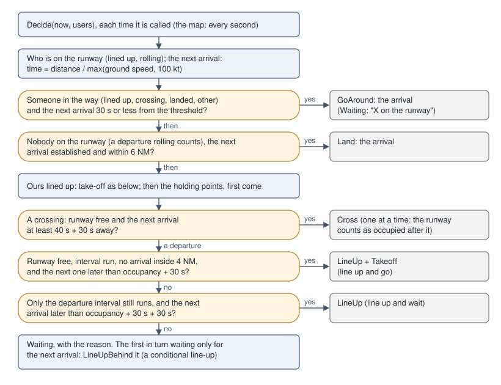

# Runway & Air Decisions

This page explains how the traffic makes its choices on the runway and in the air, with the numbers the code uses. Use it to check a decision you see on the airport map: why a departure is still waiting, why an arrival was slowed or vectored, or why a climb was restricted. Each number names its constant and the file it is in. Behaviour is described as the code does it today. Where something is unclear, the page says so. Decisions on the ground are on [Ground Decisions](traffic-decisions-ground.md).

The API around these decisions is described in [Airborne Separation](traffic-separation.md) and [Radio](traffic-radio.md).

**Diagrams.** Flow charts are images in `docs/images/traffic-decisions/`.

## The runway

### The runway controller

`RunwayController.Decide` (`pkg/traffic/runway_control.go`) is the tower of one runway. On the airport map it is called every second with the runway's users.

| Option | Default | Use |
|---|---|---|
| `MinArrivalNM` | 4 NM | no take-off with an arrival inside it |
| `Margin` | 30 s | added to the occupancy (take-off) or crossing time |
| `CrossTime` | 40 s | how long a crossing takes |
| `GoAroundAt` | 30 s | an arrival this close with the runway not free goes around |
| `ClearToLandNM` | 6 NM | the next established arrival is cleared to land within it |
| `LineUpTime` | 60 s | a departure at a holding point takes this to line up |

**Time to the next arrival** = distance ÷ max(ground speed, 100 kt). A departure **may take off** when all of these hold:

- nobody else is on the runway (every occupant counts, not only the one listed last);
- the interval since the last departure began its roll has run (`DepartureInterval`, below);
- no arrival is inside 4 NM;
- the next arrival lands later than this departure's runway occupancy plus 30 s, and, from a holding point, plus its `LineUpTime` too.

The occupancy is `RunwayOccupancyIn`: departing 40 s (light), 45 s (medium), 50 s (heavy), 60 s (super). It is 15 % longer on a wet runway and 40 % longer on a contaminated one. A medium on a dry runway lined up needs the next arrival 75 s away, about 2.9 NM at 140 kt, so the 4 NM rule decides first. From a holding point it needs 135 s, about 5.3 NM at 140 kt.

Only an arrival established on the final is sent around (`GoAround`); one on its procedure passing near the threshold is not. On the airport map, a take-off clearance given to a departure lining up or lined up, not yet rolling, is cancelled ("hold position, cancel take-off") only for someone on the runway (`cancelTakeoffFor`), never for an arrival closing in: stopped on the runway it would send the arrival around. A departure told to line up behind an arrival that then goes around is cleared afresh.

At the holding points, departures and crossings go first come, first served, by when each was first seen holding:

- A **departure** that may take off gets line-up and take-off together. If only the interval still runs and the arrival leaves the time lining up to a stop takes (`LineUpWaitTime`, 85 s, measured live; not the 60 s of line-up and go), the occupancy, 30 s and another 30 s, it gets "line up and wait". Live, a DA-42 at B lined up 100 s after its clearance and the A320 behind it on final went around.
- "Behind the departing …, line up and wait" is given behind one of ours only once that one is cleared for take-off. One lined up and waiting for an arrival is not about to go, so nobody lines up behind it.
- If the runway is taken by one of ours lined up, the departure is "number N for departure"; otherwise it waits for "X on the runway".
- The first departure in turn that waits **only** for the next arrival (the interval has run) gets `LineUpBehind`: line up behind that arrival once it has passed.
- A **crossing** needs the runway free and the next arrival at least 40 s plus 30 s away. One aircraft crosses at a time.

**Go-around.** The next arrival is sent around when it is 30 s or less from the threshold and someone is in the way. In the way means lined up, crossing, still on the runway after landing, or other traffic on it. A departure already rolling does not count.

**Landing clearance.** The next arrival is cleared to land when the runway is empty, a departure on its roll included, and the arrival is ours, established on the final and within 6 NM.

**Departure intervals** (`wake.go`, `DepartureInterval`):

| Leader → follower | Interval |
|---|---|
| any, diverging routes | 1 min (`DefaultDepartureInterval`) |
| same route (SID) | 2 min (`SameRouteDepartureInterval`) |
| heavy → medium or light | 2 min (`WakeDepartureInterval`) |
| super → heavy or super | 2 min |
| super → medium or light | 3 min (`WakeSuperDepartureInterval`) |

The longest of the route and wake intervals applies.

**Speeds** (`DepartureIntervalSpeeds`, `RunwayUser.ClimbKts`). On the same route, a follower climbing `CatchUpFromKts` (20 kt) or more faster than the departure before it waits `CatchUpPer40Kts` (1 min) more per 40 kt, at most `CatchUpMax` (3 min). Otherwise it would close on the leader after take-off. At the holding points, one `DepartureFirstKts` (40 kt) or more faster on the same route, there no more than `DepartureFirstWithin` (2 min) after the other, goes first. The map takes the climb speed from `nav.PerformanceFor`, or for a business type without data from its published cruise speed. These numbers are the project's own: no source read gives them.

### Take-off clear of the arrivals' ways in

The runway rules above count only the arrivals' time to the threshold. Before a take-off clearance the map also flies the departure's way out against the arrivals' ways in (`takeoff_plan.go`): from lift-off `takeoffLiftoffNM` (1 NM) down the runway along its SID, at its altitude constraints and the climb it can make, against every arrival of ours on its STAR and approach as planned, through the conflict watch's look-ahead. Arrivals established on the final to the departure's own runway end are left to the runway rules: it climbs away from them.

When the way out meets an arrival, tower restricts the climb with the take-off clearance, as it amends a clearance before the take-off: "after departure climb to altitude 4000 feet" (`traffic.AfterDepartureClimb`, read back "after departure climb to 4000 feet"). It tries `afterDepartureSteps`, 3000, 4000 and 5000 ft above the field rounded up to the thousand, lowest first, and gives the first that keeps the departure clear (`TaxiController.LimitClimb`: the climb waypoints are capped until departure clears it higher). Only when none does is the departure held, with the arrival as its reason in `Waiting` ("TVS122 on its way in"). A restriction once given is kept while it still clears.

Once airborne, departure radar clears the climb on above the arrivals only clear of them. Where its route has a fix past the arrival it would meet, the climb comes with a crossing restriction instead of a level-off: "cross (fix) at or below (level)", a thousand feet under that arrival (`climbRestriction`, Doc 4444 12.3.2.4 a). A level-off is the fallback when no fix of its route will do.

### Priority traffic

An aircraft with priority (an emergency, see [Emergencies & Scenarios](traffic-emergencies.md)) lands number one at its own time, and the other arrivals are fitted around it. While it is within `priorityHoldNM` (15 NM) of the airport on its way in, no departure takes off; each waits with "priority traffic (call sign)" in `Waiting`.

## Arrivals

### Release onto the STAR

An arrival is released onto its STAR only when, flown ahead along it at its levels and procedure speed for `releaseLookAhead` (20 min), it keeps separated from every arrival of ours already on its way in (`release_plan.go`), as an upstream sector hands over a stream already spaced. A STAR whose first points give no level is entered at `releaseEntryFt` (10,000 ft). Otherwise the spawn waits and the manager tries again later.

### Merges planned ahead

Where the ways in of two arrivals meet, the later one is planned apart before they get there (`merge_plan.go`). Each arrival's way (its STAR and approach as it flies them, any dog-leg or longer downwind included) is flown `mergeLookAhead` (12 min) ahead against those landing before it. Where it would come within `MergeSpacingNM` (default 6 NM) of one, the later arrival loses the time before the meeting point, by speed and at most one vector (`ArrivalController.AbsorbWithin`). A merge needs no named fix in common. Less than `mergeMinNeed` (20 s) is ignored, and a meeting closer than `mergeMinWithinNM` (12 NM) along its way is left to the conflict watch. The log says it as "its way meets X's in N NM: T to lose before".

### Spacing on final

`ArrivalSpacing` (`conditions.go`) starts from the wake minimum of the pair (`ArrivalSeparationNM` in `wake.go`), at least `MinRadarSeparationNM` (3 NM):

- ICAO: J→H 6, J→M 7, J→L 8, H→H 4, H→M 5, H→L 6, M→L 5 NM; other pairs 3 NM.
- RECAT-EU (`SchemeRecat`): the A–F matrix in `recatArrivalNM`.

The code comments attribute these values to ICAO Doc 4444 and RECAT-EU. The conditions then change the spacing:

| Condition | Effect | Constant |
|---|---|---|
| 3 NM pair, reduced separation allowed: dry runway, visibility ≥ 5000 m and ceiling ≥ 1000 ft (0 counts as good) | 2.5 NM | `ReducedRadarSeparationNM`, `ReducedVisibilityM`, `ReducedCeilingFt` |
| Contaminated runway (snow, or rain at or below 0 °C) | +1 NM | `ContaminatedExtraNM` |
| Low visibility: visibility under 550 m or ceiling under 200 ft | at least 6 NM | `LVPSpacingNM`, `LVPVisibilityM`, `LVPCeilingFt` |

### Sequencing

`ApproachSequencer.Update` (`sequencer.go`) orders the arrivals of one runway end.

**ETA.** The distance to go is flown at the ground speed now (at least the final ground speed), the last `FinalNM` (10 NM) at the average of the two, and inside 10 NM at the final ground speed. The final ground speed is `max(80, final airspeed − headwind)`, with a final airspeed of 140 kt by default. For example, 30 NM to go at 250 kt in calm air: 20 NM ÷ 250 + 10 NM ÷ 195 = 7 min 53 s.

**Gap.** The gap between two landings is the spacing flown at the follower's final ground speed. With `TimeBased`, the airspeed is used instead, so a headwind does not stretch the time. The gap is at least the leader's landing occupancy on the surface: 45, 50, 60 or 70 s for light, medium, heavy or super. Examples in calm air at 140 kt:

| Leader → follower | Spacing | Gap |
|---|---|---|
| B77W (H) → A320 (M), ICAO | 5 NM | 2 min 9 s |
| the same, RECAT-EU (B → D) | 4 NM | 1 min 43 s |
| A320 → A320 | 3 NM | 77 s |
| A320 → A320, reduced allowed | 2.5 NM | 64 s |
| A320 → A320, 20 kt headwind (distance kept) | 3 NM | 90 s |

**Order.** Arrivals inside `FreezeNM` (8 NM), or `Fixed`, keep their predicted time. The others are taken first come, first served, by the prediction they had when they joined, or their prediction now if it is earlier (a shortcut). Two of them change places only when their keys part by more than `SwapMargin` (90 s). Each takes the earliest time that keeps the gap behind the one before it, and is pushed behind any planned landing it would come within a gap of. Its delay is that time minus its ETA. A delay change under `DelayStep` (30 s) is not reported. `Move` lets a controller change the order, and `Rejoin` re-sequences an arrival after a go-around like a newcomer. The airport map uses `MinSpacingNM` 5 (`sepMinNM`), so 5 NM is the least spacing whatever the wake.

**Compression.** A follower faster on final than its leader closes on it all the way down, and any error in either prediction comes off the spacing. Its spacing grows by `CompressionNMPer30Kts` (1 NM) per 30 kt of difference in approach speed, at most `CompressionMaxNM` (2 NM; negative: none), shown as "compression". A B738 at 140 kt behind a PC-24 at 108 kt gets about 1.1 NM more. Live at LKPR without it, TVS251 behind the PC-24 OKCAQ was 31 s short on the final and went around.

**Tactical swaps.** First come, first served can waste time. An arrival slowed on its downwind keeps its place ahead of one that could now land first. So two neighbours already in the sequence, neither fixed, change places when the swap cuts their delay by `TacticalSwapGain` (60 s) or more, and costs the one moved back no more than `TacticalSwapMaxCost` (3 min). Their order keys are exchanged, so the next look keeps the new order, and neither is swapped again for `TacticalSwapHold` (3 min): the one moved back is given its delay, and its new prediction must not swap it straight back (live, three arrivals traded places every few seconds without it). A newcomer, an arrival placed by `Move` and one told to follow another (`Behind`) are never swapped. Live at LKPR, OKYDV could land before TVS223, which was turning base with room to extend. **Fixed arrivals keep their order:** one established on the final is never passed by another fixed later that is closer in by its prediction. The one behind shows the spacing it lacks (`ShortBy`).

### Delay absorption

`PlanAbsorption` and `ArrivalController.AbsorbDelay` (`absorb.go`) lose a delay on the STAR, before the final. The align and join points are never changed.

1. **Speed.** The new speed is `STAR NM ÷ (STAR NM ÷ speed + delay)`, rounded down to tens of knots, if that is not below `MinProcedureSpeedKts` (210 kt, turboprops `MinProcedureSpeedTurbopropKts` 170 kt). Within `SpacingSlowNM` (30 NM) of the end of its STAR, or when the time must be lost before a merge, the floor is `ProcedureApproachSpeedKts` (180 kt), the speed the arrivals ahead fly from the initial approach fix: speed comes before a vector. For example, 40 NM at 250 kt with a 1 min delay gives 226 kt, assigned as 220 kt. An arrival already flying that speed is not told it again.
2. **Path.** At the minimum speed, the rest is extra track: `remaining time × minimum speed`, at most `MaxStretchNM` (30 NM). Where the STAR ends on a downwind, the downwind is extended (a trombone, each mile out adds two). Otherwise a dog-leg is flown on the longest leg ahead (not the leg into the align point), its apex on the side farther from the final approach path (`dogLegApex`), if that leg is at least `MinStretchLegNM` (3 NM). Less than 1 NM is not worth a turn. For example, 40 NM at 250 kt with a 3 min delay: 210 kt absorbs 110 s, and the other 70 s is 4.1 NM of track.
   - **One dog-leg as a rule.** A later absorption moves the apex of the dog-leg already given further out while it is still ahead, as a controller lengthens one vector. Once the aircraft has flown past it, a second dog-leg is given only for `SecondDogLegFrom` (2 min) or more still to lose; less is left to speed.
   - **No leg long enough** (near the end of the STAR): vectors from where it is, out and back to its next point. There is no 360 for spacing: orbits are for emergencies.
   - **Too short to fly.** A vector flown for less than `MinDogLegOut` (30 s) before the turn back is not given; that time is left to speed.
   - **As flown.** The rounded turns cut the apex, so it is pushed out (up to three times, at most twice the stretch) until the rounded track adds what was asked. The `ExtraNM` reported is the track added as flown.
   - **Corners.** The re-plan starts from the corner the aircraft is flying to. A corner counts as passed within 1.5 NM of it. Farther out, a corner of a turn of 30° or more (`turnedPastMinDeg`) is passed once the aircraft is within 5 NM (`turnedPastNM`) and has turned more than halfway onto the next leg (`turnedPast`): a wide turn passes well inside it. A nearly straight one is passed once the aircraft is nearer the next corner than it is.
3. **What is left** is reported in `Absorption.Left`. The airport map does not hold an arrival for the sequence: it logs "more to lose than speed and vectors take now" and asks again as the arrival flies on. Holds are only for emergencies, weather and closures ([Holds](#holds)).

On the airport map (`pkg/traffic/world/sequence.go`):

- a delay is absorbed once it reaches 30 s (`absorbFrom`), at most every 90 s per arrival (`absorbEvery`);
- an arrival new to the sequence is left alone for `settleFor` (30 s), until its prediction settles;
- **shortcuts:** an arrival with a minute or more of room ahead of it (`shortcutFrom`) is sent direct to a named fix further on its STAR (`ArrivalController.Shortcut`). It uses at most 70 % of that room (number 1: up to 15 NM), saves at least `ShortcutMinNM` (2 NM), and is given only where it can still descend to that fix at `ShortcutDescentFtPerNM` (320 ft/NM, about 3°) or less, once each 3 min, and only where it makes sense: a turn of 60° at most (`ShortcutMaxTurnDeg`), the fix 10 NM or more from the threshold (`ShortcutFixFromThresholdNM`), the leg 4 NM clear of the runway (`ShortcutAirportClearNM`) and not across the final within 20 NM (`ShortcutFinalClearNM`), with 20 NM or more of the STAR left (`ShortcutMinToGoNM`): "cleared direct to PR722".

**Closing up on the final.** An established arrival keeps its predicted time, so the sequencer cannot delay it. Instead it reports `ShortBy`: how much sooner than its spacing the arrival would land behind its leader. From 10 s short (`spacingActFrom`), the map acts before they meet:

1. Still on its STAR or downwind, the shortfall is absorbed like a delay: speed, then a longer downwind.
2. On the injected final, the arrival flies its final approach speed from now on, instead of slowing to it on the way: "number 2, for spacing reduce to final approach speed" (`ReduceToFinalSpeed`).
3. It is sent around early, not on short final, if all of these hold 20 s after it was slowed (`breakOffAfter`): it is still 25 s or more short (`breakOffFrom`), more than 3 NM out (`breakOffNM`), and already inside its spacing behind the leader, measured now along the track. The go-around re-sequences it, and the tower clears its next approach again.

### Holds

Holding is the exception, not a way to sequence. On the airport map an arrival holds only when:

- **every runway of its airport is closed** (`closures.go`): "all runways at LKPR are closed, expect holding". It leaves when a runway opens again (the sequence releases it as from any hold once its delay is down to `holdRelease`, 1 min), or after `divertAfter` (20 min) is cleared to the nearest other airport at least `divertMinNM` (30 NM) away;
- **it is told to:** the Sequence section's ⟳ button, `World.Approach(icao, callsign, "hold")`, or a scenario's `hold` action, with an expected further clearance time of at least 2 minutes.

Neither the sequencer's delays nor a conflict between two arrivals ever sends one to the hold. The holds are ours, not the simulator's (`hold.go`):

- **Where:** the first STAR point at least 15 NM from the threshold on the map (`holdFixNM`), with the STAR's inbound course.
- **Speed and legs:** 230 kt up to 14,000 ft, 240 to 20,000, 265 to 34,000, 280 above (`HoldSpeedKts`). The outbound leg is 1 min up to 14,000 ft and 1.5 min above (`HoldLegTime`). Turns are rate one.
- **Entry** (`Hold.Entry`), measured from the inbound course for right turns (mirrored for left): direct from 70° on the non-holding side round to 110° on the holding side, teardrop for the next 70°, parallel for the remaining 110°.
- **Stack** (`HoldStack`): levels 1000 ft apart from 6000 ft on the map (`holdBaseFt`). Aircraft leave from the bottom, and the ones above step down.

## Conflicts

`PredictConflicts` (`conflict.go`) flies every pair of airborne aircraft on as they are: track, ground speed and vertical speed. A vertical speed under 300 fpm counts as level. With `ConflictOptions.Route` an aircraft is flown along its route's points ahead, turning where they turn; with `Profile` also toward each point's altitude. The map gives ours their routes: arrivals their STAR and approach, departures their climb, en-route traffic its plan. It looks ahead `LookAhead` (5 min) in `Step` (10 s) steps. A pair is in conflict when it is closer than both minima at the same step:

- lateral `EnrouteSeparationNM` (5 NM), or `TerminalSeparationNM` (3 NM) when both are at an airport and below 10,000 ft;
- vertical `VerticalSeparationFt` (1000 ft).

Pairs are skipped when the tower separates them (`TowerPair`: same airport, one below `TowerBelowFt`, 2500 ft above the ground) or when they cannot meet within the look-ahead. The airport map uses the same 5 NM and 3 NM (`conflictOpts`, `sepTerminalNM`) and checks every 5 s.

`ResolveConflict` tries changes to one of ours, cheapest first, and takes the first that keeps it clear of everyone through the look-ahead. Both aircraft are tried; on equal cost the first aircraft of the pair is chosen. Other traffic is never steered. What comes first depends on the geometry: tracks within `SameRouteDeg` (45°) of each other are on the same route (in trail), more apart they cross.

| Change | Crossing | Same route |
|---|---|---|
| Climbing (descending) toward the traffic: cross a fix of its route ahead at or above (below) the traffic's level plus the vertical minimum, where it makes that at its rate now (the nearest such fix) | 0.6 | 3.6 |
| Climbing (descending) toward the traffic: stop as close to its level as the vertical minimum allows, every level back to the next one, closest first | 0.7 (+0.002 per level back) | 3.7 |
| Level now, its route climbing or descending ahead: maintain the level | 0.7 | 3.7 |
| Stop the climb or descent at the next 1000 ft on its way / the one after | 0.8 / 1.3 | 3.8 / 4.3 |
| Level ±1000 ft (at 1500 fpm, not below 1500 ft above the ground; never back against a climb or descent) | 2.5 | 5.5 |
| Level ±2000 ft | 3.0 | 6.0 |
| Level against the semicircular rule (level at 10,000 ft or above: odd thousands eastbound) | +1 | +1 |
| Speed × 0.9 or × 1.1 (not above 250 kt below 10,000 ft) | 5.0 | 1.5 |
| Speed × 0.8 or × 1.2 | 5.5 | 2.0 |
| Shortcut: direct to a named fix past the next (`DirectFixes`; ≥ 5 NM away, ≤ 60° off), + turn/60 | 4.5 | 2.5 |
| Heading 20° right / left (a leg extended) | 3.44 / 3.54 | 3.44 / 3.54 |
| Heading 30° right / left | 3.67 / 3.77 | 3.67 / 3.77 |
| Heading 45° right / left | 4.0 / 4.1 | 4.0 / 4.1 |

On the map only ours en route and our departures handed to MSFS AI are steered, and an aircraft flying a TCAS RA is not ([TCAS](traffic-world.md#tcas)). A departure is never given a speed change (live, AUA818 was told "reduce speed to 200 knots" climbing out). A stopped climb or descent goes on at the first look where the aircraft is out of conflict and either the look-ahead has run or it is moving apart from the traffic it was stopped for, at least 3 NM away (that traffic gone counts too). It is cleared on to the level departure cleared it to ("climb to flight level 240", `departureClimbFt`) for a climbing departure, else to the highest (lowest) level of its planned route. A departure given a level below that cleared level counts as stopped too, so a capped climb is always resumed. Ended before the change runs out, the route planned before the change is flown again from where it is. A departure stopped before departure answers its check-in is told "identified" alone: the climb comes with the clearance on. Another kind of change given meanwhile keeps the stop to be cleared on.

A departure handed to MSFS AI climbs to the cleared level, not only to the top of its SID: on its identification ("identified, climb to flight level 240") and when a stop is cleared, `TaxiController.ClimbTo` raises the rest of its climb route to that level (`climbOn`). Cleared before the hand-over, the climb waypoints are raised as they are made.

The resolved aircraft flies the change for the look-ahead and then goes back to its route (`ResolvedRoute`). On the map it is not steered again for 5 min. Two of our arrivals on their STARs are not steered by the en-route resolver (`resolveArrivals` in `pkg/traffic/world/conflicts.go`). The one landing later acts, looked at again every 90 s (`arrivalConflictRecheck`):

1. More than 20 NM to go (`arrivalLevelFromNM`), once per pair, for 20 NM of its STAR: still 1000 ft or more above the other, it stops its descent 1000 ft above it, rounded up to 500 ft. Level with it or less than that above it, it stops its descent where it is (rounded down to 500 ft, not below `arrivalDescendMinFt`, 4000 ft) and the one ahead descends away on its own STAR. An arrival is never climbed and never sent down under the other.
2. It also loses time as the approach "slow" does (speed, then a dog-leg). Just slowed by the sequence and the conflict more than a little way off (`arrivalConflictSoon`), that speed is left to work first.
3. Once nothing more can be absorbed, it is not held: the level split and the next look keep the two apart.

## Checking a decision

These are the places that show a decision:

- **Runway:** `RunwayClearances.Waiting` gives the reason each departure or crossing waits. `GET /api/runways?icao=` lists each runway's users on the map.
- **Sequence:** `SequenceEntry` has `Number`, `Leader`, `SpacingNM`, `SpacingWhy`, `ETA`, `Landing` and `Delay`. `Absorption.String()` says how a delay is lost ("210 kt, +4.1 NM").
- **Conflicts:** `GET /api/separation` returns the closest pairs, the conflicts and the resolutions on the map ([Keeping apart](traffic-separation.md#keeping-apart)).
