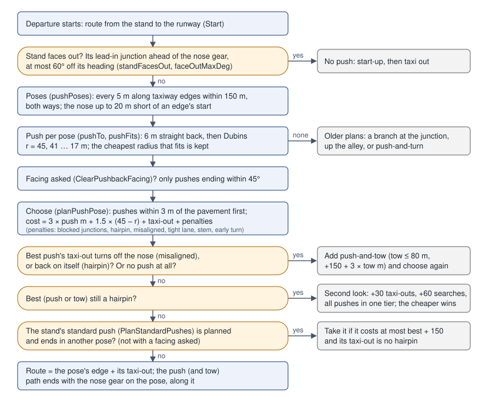
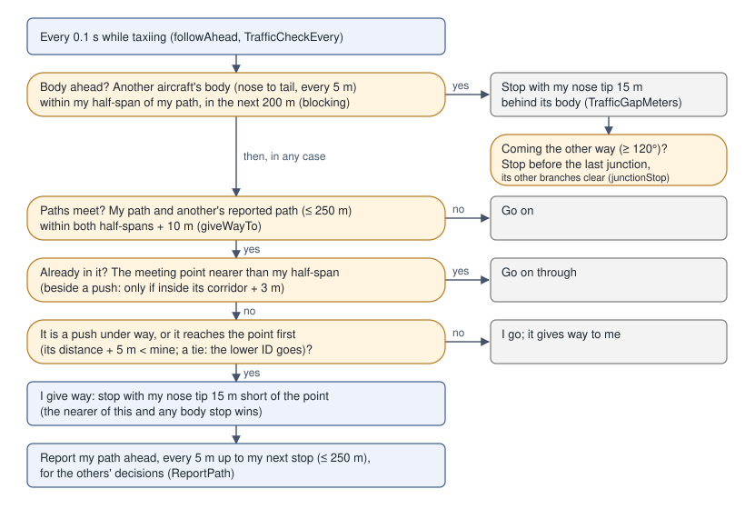

# Ground Decisions

This page explains how the traffic makes its choices on the ground, with the numbers the code uses. Use it to check a decision you see on the airport map: why a stand pushed onto that taxiway, why an aircraft stopped, or why a route takes a longer way. Each number names its constant and the file it is in. Behaviour is described as the code does it today. Where something is unclear, the page says so. Decisions in the air and on the runway are on [Runway & Air Decisions](traffic-decisions-air.md).

The API around these decisions is described in [Departure Taxi](traffic-taxi.md), [Airport Layout & Taxi Routing](airport-layout.md) and [Radio](traffic-radio.md).

**Units.** Ground costs are in **meters of taxiing**. A route of cost 1200 is as good as 1200 m of straight taxiway with no turns, so a penalty of 400 means "worth 400 m of taxiing to avoid".

**Diagrams.** Flow charts are images in `docs/images/traffic-decisions/`. Geometry is drawn in text, north up and not to scale.

## Pushback choice

An injected departure (`TaxiWithInjector`) plans its pushback when it starts (`TaxiController.Start` → `planPushback`). The push is planned to where it ends, not along the stand's lead-in line. The planner picks a **pose**: the nose gear on a taxiway, the aircraft along it, facing the way it will taxi out. Then it finds a path the tug can push to that pose. The code is in `pkg/traffic/pushpose.go`; the shared constants are in `pkg/traffic/departure_inject.go` and `pkg/traffic/tunables.go`.



### Face out or push

A stand **faces out** when the lead-in junction of the route from it lies ahead of the parked aircraft's nose gear, at most `faceOutMaxDeg` (60°) off the stand heading (`standFacesOut`, `departure_inject.go`). The aircraft then starts up and taxis straight out, with no push. Being ahead of the stand's reference point is not enough. If the junction lies under the aircraft, behind its nose gear, the stand is pushed (EDDF B10, KJFK A15). This is decided once, when the departure starts.

### Poses

`pushPoses` lists every pose a push may end in:

- every `pushPoseStepMeters` (5 m) along every taxiway edge whose nodes are within `pushPoseReachMeters` + 300 m of the main gear, in both directions;
- with the nose gear at most `pushPoseReachMeters` (150 m) from the main gear;
- also up to `laneEndPoseMeters` (20 m) short of an edge's start, on its line. The nose is then short of where the lane begins and the tail is on the apron behind it (LKPR C31, C17).

Some edges never hold a pose:

- runways, paths along a runway, and stand lead-ins (`pushEdge`);
- the branches of a **forked lead-in**: a stand junction that splits into unnamed branches less than 90° apart, all meeting the same named taxiway (LFPG M, `forkedLeadIns`);
- edges of a taxiway whose span limit the type exceeds (`airport.KnownTaxiwayMaxSpan`: LKPR `JO` and `JB` are limited to 36 m);
- edges from which there is no way to the runway.

Two kinds of pose are allowed but marked, and they cost more (see the cost table below):

- **stem**: a single unnamed stem off a stand, which may be a lead-in or an apron lane (`leadInStem`);
- **tight**: a lane without wingtip clearance from the stands beside it (`Graph.Fits` fails).

Every pose gets a lower bound on its cost: `max(0, distance − wheelbase) × 3` for the push, plus the shortest graph distance from the pose to the runway's holding point (`metersToRunway`). Poses are tried cheapest bound first. A taxi-out is planned only for the pushes that could still win: at most `pushPoseRoutes` (30) taxi-outs in at most `pushPoseSearches` (60) route searches.

### The push to a pose

```
   pose: nose gear on the taxiway, facing the way out
        o------->  heading
        |
        |<- wheelbase ->|            the push ends with the main gear
        *===============o            one wheelbase behind the nose gear
       main gear
          \
           \   Dubins path: shortest path of turn radius r
            \  (r = 45, 41, 37, ... 17 m; the cheapest that fits)
             |
             |  PushStraightMeters (6 m) straight back first
           [stand]
```

`pushTo` takes the main gear `PushStraightMeters` (6 m) straight back off the stand, then the shortest path of turn radius `r` (a Dubins path, `pushturn.go`) to the point one wheelbase behind the pose's nose gear. The path arrives along the pose's heading. Radii run from `PushbackArcMeters` (45 m) downwards in 4 m steps while `r ≥ PushbackMinArcMeters − 0.01`. With `PushbackMinArcMeters` at 14 m, the tightest radius tried is 17 m. Each radius below 45 m costs `PushTurnRadiusCost` (1.5) per meter, and the cheapest radius that fits is kept for the pose.

**Wide turns.** The whole choice is planned twice: with `PushWideRadiusCost` (3) per meter of radius given up, which favours wide turns that end aligned on the taxiway, and with `PushTurnRadiusCost` (1.5). The wide plan is kept when it is the same push, only smoother (`wideKeeps`): it ends facing within `pushWideFacingDeg` (20°) of the other, neither has a tow, it is aligned and no hairpin wherever the other is, and it is at most `PushWideMaxExtraMeters` (25 m) longer. Otherwise the 1.5 plan is taken. Setting `PushWideRadiusCost` equal to `PushTurnRadiusCost` plans once. A push drawn for the stand (`SetCustomPush`) skips all of this and is flown as drawn. One given only as an end pose (`PushRoute` with `Nose` and `Facing`, no `Points`) is planned like any push but ends there: only poses within 25 m of it, facing within 30°, are tried.

A push **fits** (`pushFits`) when all of these hold:

| Check | Limit | Constant |
|---|---|---|
| Path length | ≤ 150 m | `pushPoseMaxMeters` |
| Total heading change along the path | ≤ 200° | `pushMaxTurnDeg` |
| Heading change beyond the net turn from stand to pose (no loops) | ≤ 60° | `pushMaxSwerveDeg` |
| Main gear off the pavement | ≤ 8 m | `pushOffPavementWideMeters` |
| Nose and tail at the pose off the pavement | ≤ 8 m | `pushOffPavementWideMeters` |
| Tail, wingtips and nose inside a neighbouring stand or the terminal zone | no deeper than the parked aircraft already is, plus 1 m | `pushClearanceSlackMeters` |

**Pavement.** The pavement is modelled from the scenery's taxi data (`pavementAround`, `laneEnds` and `junctionFillets` in `pushpose.go`). It is made of:

- the stand circles;
- the taxi path strips, half their width either side (12.5 m when the width is unknown);
- 45 m of apron past the end of a lane that dead-ends or turns into an unnamed connector (`laneEndMeters`; the lane does not go on within `laneEndDeg`, 30°);
- a disc at every junction or bend of 30° or more, `filletMeters` (10 m) beyond the widest lane there.

A push whose main gear stays within `pushOffPavementMeters` (3 m) of this pavement, with its pose's nose and tail too, is **near**. The others are on the "wider apron" and only win when no near push exists (see [Choosing](#choosing)).

**Neighbouring stands** (`flatPave.withStands`, `intrusion`):

- Counted: stands within 200 m of the stand. Not counted: the aircraft's own stand, the stands that overlap it (`Layout.ParkingConflicts`: nobody parks there while it is taken) and stands `TaxiRequest.StandOccupied` reports empty. Without `StandOccupied`, every neighbour counts as taken.
- The **terminal zone** of every gate always counts, taken or not. It starts 5 m before the gate's parked nose (`pushTerminalMarginMeters`), reaches `pushTerminalDepthMeters` (40 m) towards the building, and is as wide as the stand's radius.
- Sampled points: along the push, at every second path point, the tail (`TailMeters` behind the main gear, default 20.5 m), both wingtips (half the span either side of a point 2 m ahead of the gear) and the nose (`pushNoseFactor` 1.35 wheelbases ahead).

The push is planned again when it begins if a neighbouring stand has been taken or freed since (`startPushback`).

### Cost

Each push to a pose costs (`planPushPose`, the `choose` closure):

| Term | Value | Constant (file) |
|---|---|---|
| Push length | 3 × meters pushed | `pushCostFactor` (departure_inject.go) |
| Turn radius given up | 1.5 × (45 − r), or 3 × in the wide plan | `PushTurnRadiusCost`, `PushWideRadiusCost` |
| Taxi from the nose to the far node of the pose's edge | meters | `pushPose.taxi` |
| Taxi-out from that node to the runway | the route's search cost (length plus the [routing penalties](#taxi-routing)) | `Graph.RouteToRunwayFrom` |
| Each junction of another named taxiway under the aircraft at the pose | +400 | `pushBlockPenalty` |
| Hairpin: the taxi-out turns back by ≥ 110° within 200 m, counting the corner at its first node seen from the nose | +1000 | `pushHairpinPenalty`, `pushHairpinDeg`, `pushHairpinMeters` |
| Misaligned: the taxi-out point 10 m ahead of the nose is more than 20° off its heading, or the point 20 m ahead more than 45° | +2000 | `pushMisalignPenalty`, `pushTaxiStart*`, `pushTaxiAlign*` (pushpose.go) |
| Tight lane | +500 | `pushTightPenalty` |
| Pose on an unnamed stem off a stand | +400 | `pushLeadInPenalty` |
| Early turn: degrees the taxi-out lies off the nose 30 m ahead | 3 × degrees | `pushEarlyTurnCost`, `pushEarlyTurnMeters` |

**Blocked junctions** (`poseBlocks`). A junction counts when it has three or more edges and one of them is a named taxiway other than the pose's lane (not a stand). It must lie under the aircraft standing at the pose:

```
                 <-------- wheelbase + tail --------><- 0.35 wb ->
   ^          +----------------------------------------------+
   half span  |                                              |
   v          tail ===================*==============o====> nose tip
   ^          |                     main            nose     |
   half span  |                     gear            gear     |
   v          +----------------------------------------------+
   a junction of another taxiway inside the box: +400 each
   (not the junction of the stand's own lead-in)
```

**Hairpin from the nose** (`pushPose.hairpin`). The taxi-out route starts at the node ahead of the pose, so its own shape misses the corner at that node. The corner is therefore also checked from the nose: nose → first route point → second route point.

```
   nose o------------>+ first node of the taxi-out
                     /
                    /  turns back 127° here: a hairpin (+1000)
                   /
```

This is LKPR B9 for 24 before the fix: facing east 23 m short of B2's junction, then 127° round onto B1, a 130 m loop in the sim (comment on `hairpin`).

**Misaligned and early turn.** Both look along the taxi-out from the nose:

```
   nose o----------|----------|----------|------>  pose heading
                  10 m       20 m       30 m
        point 10 m ahead > 20° off  -> misaligned (+2000)
        point 20 m ahead > 45° off  -> misaligned (+2000)
        point 30 m ahead: 3 per degree off (early turn)
```

The early-turn cost decides between two poses that are both aligned: the one already facing along the taxi-out wins (`pushEarlyTurnCost` comment: LKPR A3 for 24 goes onto A1 facing north, not onto AA facing west and turning onto A1).

### Choosing

1. **Facing asked.** If the push was cleared with `ClearPushbackFacing("west")`, only pushes ending within `pushFacingDeg` (45°) of that compass heading are kept. If none ends that way, all of them are kept. Once the push has begun the call returns `ErrTooLate`.
2. **Two tiers.** Near pushes (within 3 m of the pavement) compete first. Pushes on the wider apron (within 8 m) are considered only if no near push has a taxi-out. Within a tier the lowest cost wins.
3. **Push and tow.** If there is no push at all, or the best push is misaligned or a hairpin, `pushAndTow` adds candidates. The tug pushes to one pose (one of the 12 cheapest pushes, `towPushes`), then tows the aircraft forward to another pose. The tow is at most `towMaxMeters` (80 m) and ends `towAlignMeters` (20 m) straight along the pose, at radii 45 down to 17 m. A tow costs 3 per meter, plus `towPenalty` (150), plus the radius term. It has the same pavement (8 m) and neighbour checks as a push. Then the choice is made again. A push onto the taxiway facing the runway is never turned round by a tow.
4. **Second look.** If the winner is aligned but still a hairpin, the budget grows by 30 taxi-outs and 60 searches. Near and wider-apron pushes then compete in one tier. The result is taken only if it is cheaper.
5. **Standard push.** If the stand has a standard push (see below), no facing was asked, and the winner ends in another pose, the pushes ending in the standard pose are considered (one tier, extra budget). One is taken if it costs at most `standardPushMargin` (150) more than the winner and its taxi-out is no hairpin. Two poses are the same if they are on the same edge, in the same direction, within 30° (`samePose`).
6. The departure route becomes the pose's edge plus its taxi-out. The push (and the tow) ends with the nose gear on the pose, along it.

**Standard push per stand** (`PlanStandardPushes(graph, model, stands)`). For each stand, the push is planned for each end of the airport's two longest runways, with the stand's neighbours all taken. If one pose is chosen by more than half of those ends, and by at least two of them, it becomes the stand's standard push. Departures planned before this finishes plan as usual. `SaveStandardPushes` writes the plans so far (each stand: the pose edge and heading, or none), and `LoadStandardPushes` reads them back. A file saved for another layout of the airport, or by another planning version, is refused with `ErrStandardStale`. The World plans on demand, for `FSLTL_B738_RYR` (`standardPushModel` in `pkg/traffic/world/run.go`): the stand of each departure placed, when its standard push is not known yet (`HasStandardPush`), one stand at a time in the background, resting after each so it uses about 15% of one core. Plans are kept per layout, shared by every graph of it. They are saved after each stand to the user cache folder (`mrlm-simconnect/airport-map/pushes/ICAO.json`), and an airport's saved ones are loaded with its first departure, so a stand is planned once. The standard pose is only a preference. A type that cannot make that push gets no candidate in that pose and keeps its own choice.

### When no pose is reachable

A few stands have no reachable pose (for example remote stands far from a taxiway). They use the older plans in `departure_inject.go` (`choosePushback`, described in [Injected pushback](traffic-taxi.md#injected-pushback)). Their numbers:

| Rule | Value | Constant |
|---|---|---|
| Swing of the tail onto a branch at the junction | ≤ 100° | `maxPushSwingDeg` |
| Wider swing, only when no ordinary push leaves the taxiways clear (none, or each blocks a junction) | ≤ 125°, +150 | `maxPushSwingWideDeg`, `pushWideSwingPenalty` |
| Straight on (a swing under 45°) across a named taxiway behind the stand | not allowed (except up an alley) | `minPushSwingDeg` |
| Junctions considered: the first, and on along the route up to 250 m with no bend over 45° | | `pushAlleyMeters`, `pushAlleyTurnDeg` |
| A straight push to a later junction: within 150 m, 25° of the push direction, 3 m of the stand axis; otherwise an alley push | | `pushCorridorMeters`, `pushCorridorDeg`, `pushOffAxisMeters` |
| Cost | taxi-out + 3 × meters pushed + 400 × blocked junctions | `pushCostFactor`, `pushBlockPenalty` |
| Blocked: junctions within half span + 5 m of the body (wheelbase + `PushTailMeters` 20 m + tail along the lane); up an alley also every junction of another taxiway passed, and every crossroads of three branches leading on 80 m or more | | `pushBlocks`, `alleyBlocks`, `crossroadsBranchMeters` |
| Hairpin (≥ 110° within 200 m) / misaligned (> 60° within 20 m) | +1000 / +2000 | `pushHairpin*`, `pushMisalign*` |
| Push-and-turn on the apron instead: no branch, or the best one is a hairpin or misaligned and a clean push-and-turn fits | | `cleanPushTurn` |
| Pushes tried before keeping the last: tightest turn ≥ 11 m (`PushbackMinArcMeters` − 3) | 6 | `pushPlanTries`, `pushPathFits` |

### Worked examples at LKPR

The numbers below come from running the planner on the LKPR test data (`pkg/airport/testdata/LKPR.json`) for `FSLTL_B738_RYR`, with every neighbouring stand taken. Costs are rounded. The taxi-out cost includes the turn and crossing penalties, so it is larger than the route's length. Different scenery, a different type or empty neighbours can change them.

#### A3: onto A1, facing north-north-west

A3 faces 245°, away from A1. Its lead-in meets A1, which runs north-north-west to Z; AA leaves the same junction to the east.

```
              to Z (06, 12, 30) / A (24)
                  ^  A1
                  |
                  o  nose gear 6 m up A1, facing 339°
                 /|
   [A3]=========+-+------ AA (east)
   faces 245°     |  A3's lead-in junction (its own: never counted as blocked)
                  |  the aircraft lies along A1, tail to the south
                  |
                  A1 (south)
```

The push is 92 m at r = 17 m: 3 × 92 + 1.5 × (45 − 17) ≈ 317.

| Runway | Pose | Push | Nose to node | Taxi-out | Early turn | Total | Tier |
|---|---|---|---|---|---|---|---|
| 24 | AA facing 359° | 341 (104 m) | 25 | 568 | 6 | **939** | wider apron |
| 24 | **A1 facing 339°** | 317 (92 m) | 26 | 611 | 1 | 955 | **near**: chosen |
| 06 | **A1 facing 339°** | 317 | 26 | 4569 | 1 | **4913** | near: chosen |
| 06 | A1 facing 334° | 330 | 6 | 4575 | 2 | 4913 | wider apron |

For 24 the AA pose is cheaper, but its push leaves the modelled pavement by more than 3 m, so the near push onto A1 wins. Pushes for 12 and 30 also end on A1 facing 339°. A1 is also the standard push. The taxi-out for 06 is A1, Z, H, F, spoken "Z, H, F": the run on A1 is shorter than 150 m ([spoken taxiways](#spoken-taxiways)).

#### A5: onto B1, nose on its own junction

A5 faces 065°. Its lead-in meets B1, which runs north-north-west to H and Z. B2 leaves B1 to the west, 45 m further south.

```
            to H (06, 12, 30) / Z (24)
                 ^  B1
                 |
      A5 lead-in o======================[A5]   faces 065°
                 |  nose gear on A5's junction, facing 328°
                 |  aircraft along B1, tail about 36 m down it
                 |
     B2 <--------+  B1/B2 junction: just behind the tail, not blocked
                 |
                 B1 (south, to A6, A7)
```

| Runway | Pose | Push | Nose to node | Taxi-out | Total |
|---|---|---|---|---|---|
| 24 | **B1 facing 328°** | 227 (62 m) | 35 | 870 | **1132** |
| 24 | B1 facing 328°, 30 m further | 225 (61 m) | 4 | 905 | 1134 |
| 24 | B2 facing 282° | 335 (98 m) | 32 | 981 | 1348 |
| 06 | **B1 facing 328°** | 227 | 35 | 4275 | **4538** |
| 06 | B2 facing 282° | 335 | 32 | 4275 | 4643 |

All four runway ends push onto B1 facing 328°. Two earlier failures shaped the rules here:

- KLM594 was pushed onto B1 facing south-east, taxied 80 m and turned 127° back onto B2. The hairpin penalty now prevents this (comment on `hairpinAfterPush`).
- For 24, aircraft were pushed 134 m west into the crossroads of the B1 lanes. Crossroads now count as blocked junctions in the older alley plans (`alleyBlocks`).

#### B9: the standard push onto B2

B9 faces 213° at the end of an alley of B2. The planned pushes go 100 m back across the apron behind the stand, to the lane where B1 and B2 fork.

```
              B1 (north, to Z: the way to 24)
               ^
               |      B2 (west, to H: the way to 06, 12, 30)
   B2 <--------+---o  nose gear 8 m short of the fork, facing 298°
              /|      (the standard push)
             / o  nose gear on B1 facing 327° (24 alone, without the standard push)
            /  |
           /   push about 100 m back across the apron
          /
     [B9]   faces 213°
```

| Runway | B2 facing 298° | B1 facing 327° | Without a standard push | With the standard push |
|---|---|---|---|---|
| 06 | **4716** | 4721 | B2 | B2 |
| 12 | **1835** | 1840 | B2 | B2 |
| 30 | **3589** | 3594 | B2 | B2 |
| 24 | 1421 | **1315** | B1 | **B2** (106 more, within 150) |

Three of the four ends choose B2, so B2 facing 298° becomes the stand's standard push. For 24 the B2 push costs 106 more than B1, which is within `standardPushMargin` (150). B9 therefore pushes the same way for every runway (`TestStandardPush`).

#### C17: onto JB, the tail past the lane's end

C17 faces 214°. Its lead-in junction is where JB begins and runs west-north-west. An unnamed connector goes on from the junction to J.

```
                                 J
                                /  unnamed connector to J
   (west, to H) <--- JB ---o---+   C17's lead-in junction: JB starts here
                           |    \
             nose gear 11 m |     \  tail over the apron past JB's end
             up JB, 304°    |      \ (laneEnds: 45 m of apron counted)
                               [C17]  faces 214°
```

| Runway | Pose | Push | Taxi-out | Total |
|---|---|---|---|---|
| 24 | **JB facing 304°** | 238 (65 m) | 1382 | **1656** |
| 24 | J facing 305° | 328 (95 m) | 1358 | 1739 |
| 24 | JB facing 304°, push 64 m + tow 25 m | 458 | 1382 | 1858 |

All four runway ends push onto JB facing 304°. The tow would cost about 200 more (tow meters × 3 + 150). Here it is not even planned, because the best push is aligned and no hairpin. `JB` is limited to 36 m of span (`KnownTaxiwayMaxSpan`): a B738 (35.8 m) may end on it, a wide-body may not.

## Ground give-way

Injected aircraft at one airport share a `GroundPicture` (`pkg/traffic/awareness.go`). Each aircraft reports where it is, its heading and its body every frame:

- nose: 1.35 wheelbases ahead of the main gear (`pushNoseFactor`), measured from the reference point;
- tail: `TailMeters` + `RefAheadMeters` behind the reference point.

While taxiing it also reports its **path ahead** every `trafficBodyStep` (5 m), up to its next stop, at most `GiveWayLookMeters` (250 m). An aircraft holding at a limit or a hold-short reports no path, so it takes no priority. Reports older than `TrafficStaleAfter` (3 s) are ignored. A taxiing aircraft looks again every `TrafficCheckEvery` (0.1 s) (`groundDrive.followAhead` in `ground_drive.go`).



### Body ahead and the gap

`blocking` finds the nearest point of another aircraft's body (nose to tail, every 5 m) within the aircraft's own half-span of its path, in the next `TrafficLookMeters` (200 m). The aircraft stops with its **nose tip** `TrafficGapMeters` (15 m) behind that point. The nose tip is `(pushNoseFactor − 1) × wheelbase` ahead of the nose gear (4.4 m for the default 12.6 m wheelbase). It moves on as the other moves.

```
   me  o==>                                  [ other's body ]
       |------- stops here --|<--- 15 m --->|
                     nose tip
```

### Who gives way where paths meet

`giveWayTo` compares the aircraft's path with every other reported path. Waiting aircraft (pushed, waiting for the taxi clearance) are left out here. The two paths **meet** at the first point of the aircraft's path within both half-spans plus `GiveWayMarginMeters` (10 m) of the other's path. For two aircraft with the default 35.8 m span that is 17.9 + 17.9 + 10 = 45.8 m.

```
                 | other's path
                 |
   me ==>--------x-------->      x: the first point of my path within
                 |                  my half-span + its half-span + 10 m of its path
                 v
```

- **Already in it.** The meeting point is closer than the aircraft's own half-span, so it goes on through. Beside a push under way this applies only if its first point is already within both half-spans plus `PushClearMarginMeters` (3 m) of the push corridor. Otherwise each would wait for the other.
- **Who goes.** Each side measures how far along its own path the meeting point lies; the other's distance gets +5 m because its reported path starts one step ahead of it. The aircraft further from the point waits. On a tie the lower object ID goes. Both sides compute the same thing, so exactly one of them stops.
- **A push under way always has priority.** Taxiing traffic whose path meets the push corridor gives way whatever the distances. The exception is an aircraft whose own body (nose to tail, every 5 m) is already within the push's half-span plus 3 m of its corridor (`bodyInPush`): the push stops for it, so it goes on through, or each would wait for the other.
- **Going the same way.** One ahead on the aircraft's path facing the same way is not given way to; it is followed at the gap (`sameWayAhead`).
- **A crossing tail.** When the other's path ahead no longer meets this path but its body is still across it (it has crossed, its tail has not), the aircraft stops short of that body. The reach is its own half-span + 10 m + `TailplaneShare` (0.35) of the other's half-span, the tailplane being narrower than the wing.
- **Told to follow.** An aircraft told to follow another on the ground (ground's "follow the company Airbus A320", `GroundPicture.Follow`) gives way to it wherever their ways meet, even when it would have been there first; the leader never gives way to its follower. Ground says it with a taxi clearance when one of ours taxis ahead on the same route (within 40 m of it, up to 800 m along it, heading its way within 45°), or when the map's Follow button is pressed (`POST /api/control/{id}/follow?tail=`).
- The one giving way stops with its nose tip 15 m short of the meeting point, slowing on a gentler braking curve (`GiveWayDecelFactor`, 0.4 of its deceleration). If both a body stop and a give-way stop apply, the nearer one wins.

### Oncoming traffic keeps the junction clear

When the body ahead faces at least `oncomingDeg` (120°) off the path, the aircraft does not queue up to the 15 m gap. That would leave its nose over the junction where the other aircraft has to turn off. `junctionStop` finds the last junction on its path before the stop. It walks that junction's other branches for `junctionBranchMeters` (60 m), leaving out the branches within 20° of the path back or ahead. It then steps back 2 m at a time until the aircraft, from the nose gear to the nose tip, is at least `max(my half-span, its half-span) + 10 m` clear of those branches. If no place behind is clear, it stops where it is.

```
                      branch the other aircraft turns into (60 m kept clear)
                         |
   me ==>-----o  stop    J ------------------<== other, coming the other way
              |<-- clear of the branch by the larger half-span + 10 m
```

### Pushbacks

**Before the push starts** (`pushBlocked`), even when cleared, the push waits if any of these is in its corridor (the push path, the tail beyond its end and any tow, `corridorBlocked` with paths):

- another aircraft's fuselage within the half-span + 3 m (`PushClearMarginMeters`) of the corridor. If that aircraft is moving (it reports a path), its own half-span is added, so its wing keeps clear too. A neighbour parked on its stand counts only with its fuselage inside the corridor itself, where the wing would sweep it. It stays there until its own push, so waiting off the margin waited for that push, while the neighbour's tug and fuel truck gave way to this one (live, LKPR C26 and C27: DLH1560 held "for TVS1517 behind the stand" for over 40 minutes, its wing 14.6 m clear of TVS1517's fuselage once it pushed).
- another aircraft's reported path within both half-spans + 10 m. This includes a taxiing aircraft's path, a neighbour's push and the planned taxi of an aircraft waiting after its push. Two pushes into one corridor would otherwise each stop for the other.

**Before the stand is given** (`StandAllocator.Assign`), neighbours due off together are kept apart: a stand within 90 m (`StandPushNeighbourMeters`) of one whose aircraft is due off within 8 minutes (`StandPushConflictWindow`) of this one ranks as if its taxi-in were up to 600 m (`StandPushConflictMeters`) longer, the full amount for the same time and less as the times are further apart (`pushConflict`, `stands.go`). The map's schedule gives departures their STD and arrivals their turnaround's STD.

**Under way** (`holdPushForTraffic`) the push reports what it still sweeps (`ReportPush`), and taxiing traffic gives way to it. The push itself stops only for a fuselage within the half-span + 3 m of what it still has to sweep. An aircraft that stopped short to give way would otherwise hold it for ever. It brakes to a stop `v² / (2 × 0.25) + 0.2 m` ahead, using the push profile's 0.25 m/s² deceleration. `TaxiEvent.PushbackHeld` reports the hold.

### Service vehicles

Tugs and fuel trucks give way to aircraft on their way to and from their depot (`vehicle_yield.go`, `GroundPicture.VehicleConflict`). The vehicle looks `VehicleLookMeters` (40 m) ahead along its way. It stops `VehicleStopShortMeters` (3 m) short of the first point that comes within both half widths plus `VehicleClearMeters` (8 m) of a moving aircraft. That means the aircraft's body, or the first `VehicleAircraftLookMeters` (120 m) of its path ahead. It waits there until the aircraft has passed. A vehicle already in an aircraft's path (within `VehicleCommitMeters`, 4 m, of its front) drives on to clear it. Parked aircraft and aircraft waiting for a clearance do not count, since the roads pass them, and neither does the vehicle's own aircraft. Aircraft do not see the vehicles and keep their way. At LKPR B9 a tug meeting an A320 taxiing across its road stops about 29 m short of the crossing.

Vehicles also respect each other. Each tug and fuel truck reports itself to the airport's ground picture (`ReportVehicle`). On the roads it drives `VehicleLaneMeters` (2 m) right of the centreline, blended in over the first and last 15 m of its way, so oncoming vehicles pass each other. It stops `VehicleStopShortMeters` (3 m) short of another vehicle's body within both half widths plus `VehicleGapMeters` (3 m) of its way, as follows:

- **ahead of it:** it waits behind and follows;
- **behind it:** it ignores it, since that one waits;
- **side by side** (two leaving one depot together), **or crossing:** the one with the higher object ID waits, so two never wait for each other.

After `VehicleWaitMax` (1 min) waiting for vehicles, it drives on regardless for 20 s, so one parked on its way cannot hold it for ever. At LKPR two tugs leaving the same depot for B9 and B10 together keep at least 4 m apart.

### Braking

| | Value | Constant (tunables.go) |
|---|---|---|
| Normal stop | up to 1.5 × the profile's `Decel` (default 0.5 m/s²) | `GroundMover.step` |
| Stop for traffic found inside the normal braking distance | up to `TrafficBrakeFactor` (3) × `Decel`, jerk `TrafficJerkFactor` (6) × `Jerk` | |
| Roll on into the gap rather than stop dead | up to `TrafficOverrunMeters` (8 m) past the stop point | |
| Holding short of a runway crossing | nose gear `HoldShortStopMeters` (7 m) before the line | |

## Taxi routing

Taxi routes come from a turn-aware Dijkstra search over (node, arrived-from) states in `pkg/airport/route.go`. A route's `Cost` is its length plus these penalties; `Length` stays the real length. Zero in a `RouteOptions` field selects the default, and a negative value disables the cost (see [Route cost](airport-layout.md#route-cost-fewer-turns-no-crossings)).

| Cost | Default | Constant |
|---|---|---|
| Turn at a junction (a node with more than two edges): `60 × (angle − 15°) / 90°` | a 90° turn: 50, a 45° turn: 20 | `DefaultTurnPenalty`, `TurnFreeAngle` |
| Turning (more than 15°) at a junction from one named taxiway onto another; unnamed connectors carry the previous name | +40 | `DefaultTaxiwayChangePenalty` |
| Turning back, ≥ 150°, at any node | +2000 | `UTurnAngle`, `UTurnPenalty` |
| Each runway the edge enters (not the one it starts on: vacating or lining up is no crossing) | +1000 | `DefaultRunwayCrossingPenalty` |
| Taxiway edge along a runway surface | × 20 its length | `AlongRunwayFactor` |
| Edge touching a node where a stand connects (apron taxilane), except within 250 m of the start | + 0.5 × its length | `DefaultApronPenalty`, `DefaultOwnApronMeters` |
| Leaving a stand through a lead-in behind it (a pushback) | +200 | `DefaultPushbackPenalty` |
| Entering a stand through a lead-in ahead of it (turning round on the apron) | +3000 | `DefaultStandTurnAroundPenalty` |
| Named taxiways off a `Taxiways` custom route (not the current or the next one) | × 10 their length | `OffTaxiwaysFactor` |

For example, a 90° turn from B1 onto H at a junction costs 50 + 40 = 90 m of taxiing. Going straight on where the name changes costs nothing. A 150° U-turn onto another taxiway at a junction costs 2000 + 90 + 40.

**Fit.** With `HalfSpan` set, an edge is used only if its clearance is at least the half-span plus `DefaultWingtipMargin` (3 m). The aircraft's own stands do not count as obstacles. The edge is also refused if the taxiway's span limit is exceeded (`KnownTaxiwayMaxSpan`). If no route fits, the search runs again without the check and the route is marked `Tight`. A custom route (`Via`, `Taxiways`) returns `ErrTooNarrow` instead.

**Round aircraft in the way** (`RouteOptions.Occupied`, `occupied.go`). A departure cleared to push, pushing, or pushed back and waiting for its taxi takes a place on the taxiways: its push path still ahead, or where it stands (`TaxiController.Occupies`). A route search with `Occupied` refuses every edge that comes within both half-spans plus `DefaultWingtipMargin` (3 m) of one, since the two wings could not pass. If no route keeps clear, the search runs again without them and marks the route `Occupied`. The rule is the same at every airport; the span limits decide who has a way round.

The map checks this each second when the places taken change (`keepClear`, `pkg/traffic/world/keepclear.go`), and once more just before a taxi clearance is said. A taxiing aircraft whose route ahead passes a place too near is re-planned (`ArrivalController.AvoidOccupied`, `TaxiController.AvoidOccupied`), but only when all of these hold:

- the new route keeps clear and still fits the aircraft;
- a departure's new route crosses the same runways; an arrival has no runway crossing left ahead and its new route crosses none;
- no clearance limit (and for a departure no custom route) is set;
- the user does not control the aircraft (Manual).

Ground then says the new route from where the aircraft is. An arrival turns off at a route node beyond its stopping distance plus 10 m (`avoidTurnMeters`). Without a new route it keeps its route and gives way as before.

At LKPR a B738 pushed from C19 onto JB leaves J beside it too narrow: a CRJ on J to C18 goes "J, JO, J" and passes 43 m from it. A wide-body has no way round, because JO's 36 m span limit keeps it off JO, so it keeps J and waits.

**Which holding point** (`runwayRoute`). Runway holding points are preferred over ILS holds; ILS holds are used only when no runway hold is reachable. In low visibility procedures (`RouteOptions.LowVisibility`) it is the other way round: the ILS holds (the CAT II/III lines outside the ILS sensitive area) first. Each runway entry has its `ILSHoldShort`, the ILS hold-short further out on the same taxiway beyond its `HoldShort` (-1 none; LKPR 06 at F and E, 24 at Z), and in low visibility the route to the entry ends there; an entry without one keeps its runway hold. The airport map sets it at a departure's spawn from the weather (visibility below 550 m or a ceiling below 200 ft, `traffic.ApproachConditions.LowVisibility`). Among the holds within `DefaultIntersectionTolerance` (300 m, measured along the runway) of the one nearest the threshold, the one with the cheapest route wins.

**Intersections for the queue**. With `IntersectionQueue` (3) or more of our departures already queuing for a runway's full length (holding short, lining up, or taxiing there), ground gives the next one an intersection with its taxi clearance, so it does not join the queue (LKPR 24 at B or F). Which one follows the class of the aircraft (`traffic.IntersectionClass`) and its rule (`traffic.intersectionClasses`): the runway it must leave ahead, 2,500 m for a narrowbody jet, 1,800 m for a regional jet or an airliner turboprop, 800 m for a light aircraft, a widebody the full length only. The first place along the runway after the full length comes first (at least 300 m in; the taxiways either side of one place, as EDDM B11 and B12, are one), deeper only while the runway left is enough, and only a place whose own queue is empty; within a place the entry nearest the aircraft. Where an airport lists its own entries for a runway and class (`traffic.intersectionAirports`), only those. Live at EDDM, an A320 was given 26L at B10 with 2,250 m left; it now gets B12 (2,808 m), and nobody but a light aircraft goes from 26R at A8 (1,743 m). Some crews decline (`traffic.DeclineChance`: the class's share, times their airline's way and their weight that day, both drawn from the callsign): "Unable intersection, request full length", and ground clears them to the full length. Where the airport table says so (`sayRemaining`), the taxi clearance says the runway left: "runway 26L at B12, 2800 metres available". Crews also ask for intersections themselves, mostly light aircraft, the first their class may take. The figures are the project's estimates.

**Entries** (`entries.go`). The entries onto a runway end are the exits of the opposite end, driven backwards. Those needing a turn of more than `MaxEntryAngle` (135°) onto the runway are left out. Entries within `FullLengthMeters` (150 m) of the threshold count as full length. "24 at B" takes the reachable entry named B with the most runway ahead.

**Runway crossings on the way.** The route reports the runways it crosses (`Route.RunwayCrossings`). An injected aircraft held for clearances stops 7 m before the first hold-short line of each crossing, until it is cleared to cross. Strobes and landing lights come on 10 m past that line (`CrossingOnMeters`) and go off once the main gear is 40 m past the far line (`CrossingTailMeters`, `ground_drive.go`).

### Spoken taxiways

`Route.SpokenTaxiways` is the route as a controller says it. It drops every taxiway the route follows for less than `SpokenMinMeters` (150 m) that only leads onto the next one; the last taxiway is always kept. At LKPR from A3 to 06 the route is A1, Z, H, F, spoken "Z, H, F". From A5 to 24 it is B1, Z, A1, A, spoken "Z, A".

## Checking a decision

These are the places that show a decision:

- **Pushback:** `TaxiController.PushFacing()` gives the compass facing of the planned push. The [taxi route on the map](examples.md) shows the push and the route.
- **Ground stops:** `TaxiEvent.PushbackHeld` reports a held push. The aircraft a taxiing one gives way to is reported as `GivingWayTo` (its object ID) on `TaxiEvent` and `ArrivalEvent`.
