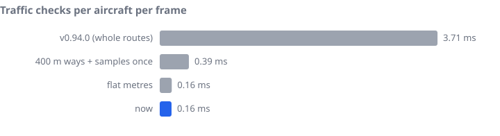
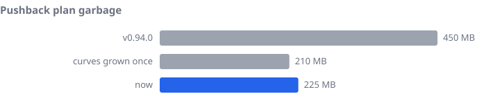
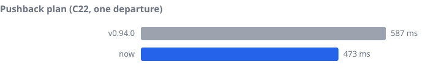
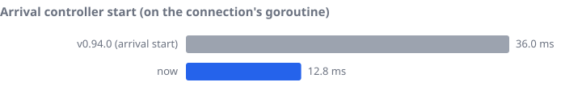
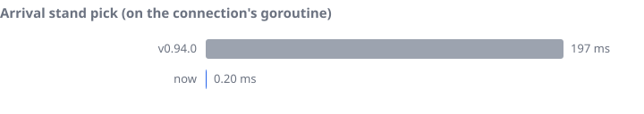
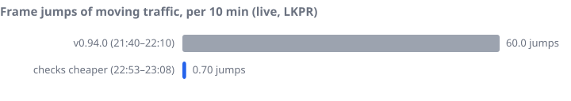

# Traffic Smoothness

Every injected aircraft (taxiing, pushing back, rolling, landing) is placed by the World on **one goroutine**: the connection's, which also takes every simulator message and runs every command. Anything slow there holds back every moving aircraft at once. Their frames queue up, then each one catches up in a single frame. On screen that is a jump of every aircraft that is moving, worst at take-off and landing speed (150 kt is 77 m/s, so 100 ms held back is a 7.7 m jump).

Smooth movement is not negotiable. One frame lasts 16.7 ms at 60 fps, and everything the goroutine does between two frames for all aircraft together must stay far below that.

## Measuring it

### Live: what the simulator shows

- **`examples/glitch-watch`** traces every aircraft the map drives, every simulator frame. It reports jumps in position, height, pitch, bank or heading, with the frames around each one saved as CSV.
  - Run it during every live test, and read its log before saying the motion is right.
  - A position jump at a steady speed, where the distance per frame stays even over wall time, is the simulator's own frame hitch: everything stutters with it. A jump where one frame carries several frames of distance after a pause is ours.
- **The slow-step log:** the World logs any step of the connection loop over 40 ms (`slowStep`), naming it:
  - `slow: command …(*controlCenter).do.func1 took 181ms`: a command, such as a spawn, ran on the loop;
  - `CSA1991 slow: its frame took 42ms (awaiting pushback)`: one controller's frame.
- **Profiler:** the airport map with `-pprof 127.0.0.1:6060` serves Go's profiler.
  - `/debug/pprof/profile` shows CPU.
  - `/debug/pprof/mutex` and `/debug/pprof/block` show waits; with `-pprof`, mutex and block profiling are on.
  - `/debug/pprof/trace` gives an execution trace (`go tool trace -pprof=sync|syscall`).

Probes that poll the simulator disturb what they measure. Asking for jetway data (`RequestJetwayData`) stalls every aircraft for about 100 ms. A probe polling it every 5 s caused about ten times the jumps (live, LKPR, 2026-10-12). Don't poll the simulator during a smoothness test.

### Benchmarks: the work behind a frame

`pkg/traffic/smoothness_bench_test.go` measures the work the connection's goroutine does, at LKPR, without a simulator:

| Benchmark | What it is |
|---|---|
| `BenchmarkGroundChecksFrame` | One taxiing aircraft's traffic checks for one frame (blocking and head-on), 20 others on the apron, every other one waiting with its whole route planned |
| `BenchmarkDepartureTaxiFrame` | One injected departure's whole frame while taxiing |
| `BenchmarkSpawnDepartureStart`, `BenchmarkSpawnArrivalStart` | A controller's start at its spawn (runs on the loop) |
| `BenchmarkSpawnDepartureRoute`, `BenchmarkSpawnArrivalPlan` | Their route planning alone |
| `BenchmarkAssignStandArrival` (world) | An arrival's stand pick at its spawn, taxi-ins worked out beforehand |
| `BenchmarkPushPlan` | One departure's pushback plan (in the background, but its CPU and garbage are the whole map's) |

Run them and draw the charts:

```sh
scripts/bench-smoothness.sh            # 10 runs each
BENCHTIME=5x scripts/bench-smoothness.sh
```

The script writes `docs/images/smoothness/bench.txt` and the charts below (`examples/smoothness-report`). Earlier measurements are in `docs/images/smoothness/history.csv`, one row per step (`chart,label,value,unit`). Add a row when a change moves a number; the newest run is the blue bar.

## What made it stutter

Live at LKPR on 2026-10-12, the moving traffic jumped about once every 5–6 s, about 60 times per 10 minutes. The slow-step log and the profiles found three causes.

1. **The traffic checks every frame.** Each taxiing aircraft checks, every frame, whether anything blocks its way or comes the other way.
   - A waiting aircraft's planned way counted as its whole route to the runway, compared point by point against about 200 samples of the path, each sample found again by walking the path.
   - Every distance and bearing took its own cosine.
   - The result was 3.7 ms per aircraft per frame, with spikes of over 100 ms.
2. **The pushback plan.** In the background, it took 0.6 s of CPU and 450 MB of garbage per departure, several at once when the schedule spawned. Its CPU and the garbage collector's work held the loop back.
3. **The spawns.** A controller's start (route and exit planning) runs on the loop: 17–36 ms on a free CPU. An arrival's stand pick ranked its candidate stands by taxi-in, about 200 route searches every time, which added another 200 ms. Live, with MSFS loading the CPU, a whole spawn took up to 280 ms.

## What keeps it smooth

- **Checks within reach:** another aircraft's way counts for its next `OncomingLookMeters` (400 m), the same as its reported intent. Only the path segments and way points that can come within reach are compared.
- **Flat metres:** points go into a local plane around the aircraft once per frame (`flat`), with plain arithmetic after that and no trigonometry per point pair.
- **Sample once:** a path's points and headings ahead are computed once per frame, not once per other aircraft.
- **Pool the scratch:** working space that does not outlive a call is pooled, never allocated per frame (`groundScratch`, the route search's `searchScratch`). Curves are built into a slice sized once (`dubinsAppend`) and turned by rotation, not by a cosine and sine per point.
- **Keep what does not change:** each stand's taxi-in from each runway end is worked out once, in the background as the airport loads (`StandAllocator.WarmTaxiIn`), and kept (`TaxiIn`).
- **One background plan at a time:** pushback plans queue (`pushPlanning`) rather than burst.
- **Nothing heavy on the loop:** planning that can run before (flight plans, pushback plans) runs elsewhere and hands its result in.

<p></p>

<p></p>

<p></p>

<p></p>

<p></p>

<p></p>

## Rules for new code

- **A frame's budget:** what a controller does per frame must cost well under 0.5 ms at a busy airport (20 aircraft around). Add a benchmark for anything new that runs per frame.
- **No planning in a frame:** routes, pushback poses and searches run in the background or before the spawn, never inside a frame. Spawning on the loop is the exception being paid down, so keep it short.
- **Probes stall the loop:** every aircraft is placed from the one connection loop, so anything that waits on the simulator there holds them all at once: a data request, a facility or jetway list, a probe of a model. Ask for such data as rarely as the feature allows (the jetway list only while something moves at a gate, `pollEvery`), never per frame or per aircraft, and take the answer as a message when it comes rather than waiting for it.
- **No garbage per frame:** reuse buffers (pool them when shared), grow slices once, and keep maps out of hot loops.
- **Measure live too:** run glitch-watch and read the slow-step log before calling a change smooth. A benchmark finds the cost; only the simulator shows the jump.
